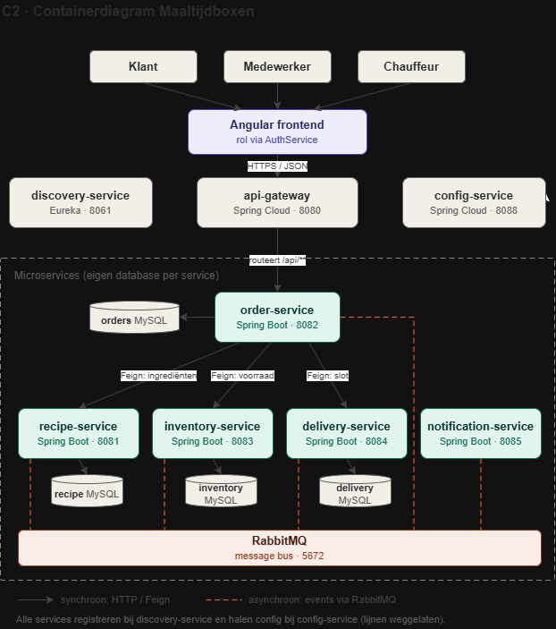
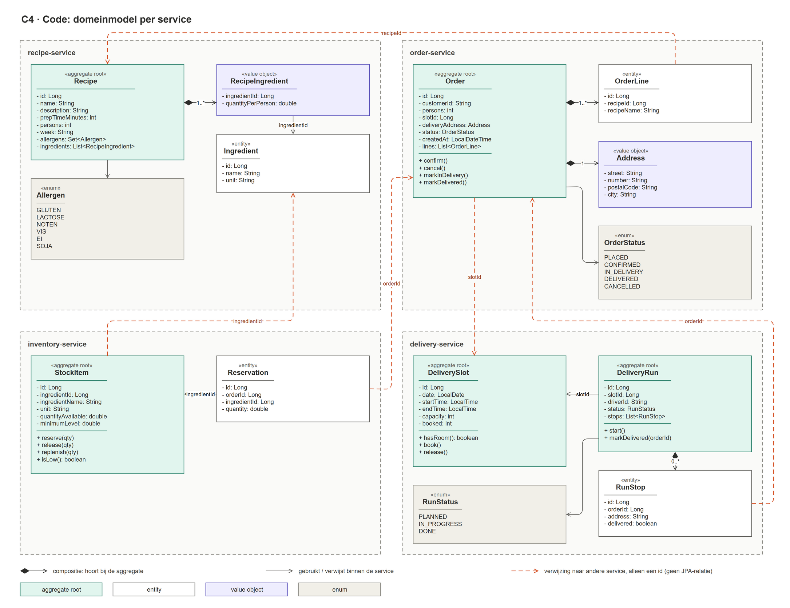

# Analyse Maaltijdboxen



## Welke services en waarom

Ik werk met vijf services: recipe, order, inventory, delivery en notification. In het begin twijfelde ik of recipe en inventory niet samen konden, omdat ze allebei over ingrediënten gaan. Toch houd ik ze apart. Een recept verandert elke week als het menu verandert. De voorraad verandert elke keer als er iets geleverd of besteld wordt. Dat zijn twee verschillende redenen om te wijzigen, en als ze samen zitten moet ik bij elke voorraadwijziging de hele recipe-service opnieuw deployen.

"Ingrediënt" betekent ook niet hetzelfde in beide services. In recipe-service is het "200 g arborio per persoon". In inventory-service is het "we hebben nog 12 kg arborio". Hetzelfde woord, maar een ander object. Daarom zijn het voor mij twee aparte bounded contexts.

Delivery heb ik apart gehouden omdat het over tijdsloten en capaciteit gaat, en omdat een chauffeur iets totaal anders wil zien dan een klant.

Een aparte customer-service maak ik niet. De klant-id komt uit de header (`X-User-Id`) en het leveradres geeft de klant mee bij het bestellen. Order-service bewaart dat adres in de bestelling zelf. Dat is een vereenvoudiging, maar voor deze case lijkt het me genoeg.

## Domeinmodel



**recipe-service**
- `Recipe`: naam, beschrijving, bereidingstijd in minuten, de week waarin het op het menu staat, allergenen, en een lijst van ingrediënten met hun hoeveelheid per persoon
- `Ingredient`: naam en eenheid (g, ml, stuk)

**order-service**
- `Order`: klant-id, aantal personen, gekozen leverslot, leveradres, status en aanmaakdatum
- `OrderLine`: per gekozen recept de recipe-id en de naam van het recept
- De status is `PLACED`, `CONFIRMED`, `IN_DELIVERY`, `DELIVERED` of `CANCELLED`.

**inventory-service**
- `StockItem`: per ingrediënt de hoeveelheid in stock en een minimum. Zakt de voorraad onder dat minimum, dan komt het bij "raakt op" (US4).
- `Reservation`: welke bestelling hoeveel van een ingrediënt vasthoudt. Die heb ik nodig om bij een annulatie de juiste hoeveelheid terug vrij te geven (US6).

**delivery-service**
- `DeliverySlot`: datum, begin- en einduur, capaciteit en het aantal geboekte plaatsen
- `DeliveryRun`: de rit van één slot, met een chauffeur en de bestellingen die erin zitten

**notification-service** heeft geen entities.

Naar een andere service verwijs ik alleen met een id (`recipeId`, `slotId`, ...). Elke service heeft zijn eigen database, dus een JPA-relatie naar een tabel van een andere service is niet mogelijk.

Een paar regels horen volgens mij in de klasse zelf en niet in de service:
- Een bestelling annuleren mag alleen zolang ze `PLACED` of `CONFIRMED` is.
- Een slot boeken mag alleen als er nog plaats is.
- De voorraad mag nooit negatief worden.

## Data die ik kopieer

Sommige gegevens bewaar ik bewust dubbel:

- De **receptnaam in `OrderLine`**. Wijzigt een medewerker later de naam of verdwijnt het recept van het menu, dan wil de klant in zijn oude bestelling nog steeds zien wat hij besteld heeft.
- De **naam en eenheid van een ingrediënt in `StockItem`**. Zo hoeft inventory-service niet bij elke opvraging recipe-service te bellen.
- Het **adres in de rit van delivery-service**. De chauffeur moet zijn adressen zien, ook als order-service even niet bereikbaar is.

Het nadeel is dat die kopieën even kunnen achterlopen (eventual consistency). Voor deze gegevens vind ik dat geen probleem.

Als een medewerker een nieuw ingrediënt toevoegt, stuurt recipe-service een event `ingredient.created`. Inventory-service maakt dan een `StockItem` met voorraad 0 aan.

## Synchroon of asynchroon

Bij het bestellen (US2) wil de klant meteen weten of het lukt. Daarom doet order-service drie Feign-calls voordat de bestelling bevestigd wordt:
- naar **recipe-service**, om de ingrediënten van de gekozen recepten op te halen
- naar **inventory-service**, om te checken of er genoeg voorraad is
- naar **delivery-service**, om te checken of het slot nog plaats heeft

Is één van die checks negatief, dan geef ik een 409 terug en wordt de bestelling niet bewaard. Ligt een van die services plat, dan vangt een circuit breaker dat op en krijgt de klant een duidelijke foutmelding in plaats van een timeout.

Alles wat na de bevestiging gebeurt, doe ik met events via RabbitMQ. Een bestelling mag niet mislukken omdat bijvoorbeeld notification-service plat ligt.

| Event | Wie stuurt | Wie luistert | Wat er gebeurt |
|---|---|---|---|
| `order.confirmed` | order | inventory, delivery, notification | voorraad reserveren, plaats in het slot boeken, klant verwittigen |
| `order.cancelled` | order | inventory, delivery, notification | reservatie en plaats vrijgeven, klant verwittigen |
| `delivery.started` | delivery | order | status wordt `IN_DELIVERY` |
| `delivery.completed` | delivery | order, notification | status wordt `DELIVERED` |
| `ingredient.created` | recipe | inventory | nieuw `StockItem` aanmaken |

Er zit één zwak punt in. De voorraad wordt synchroon gecheckt, maar pas asynchroon gereserveerd. Bestellen twee klanten op hetzelfde moment de laatste arborio, dan kunnen ze allebei de check doorkomen. Ik kies er toch voor, omdat een bestelling niet mag mislukken door iets wat pas na de bevestiging gebeurt. Inventory-service logt een waarschuwing als een reservatie niet meer lukt. Dit punt hou ik voorlopig open.

## API-paden (eerste versie)

Rol en gebruiker lees ik uit de headers `X-User-Role` en `X-User-Id`. Doet iemand iets met de verkeerde rol, dan geef ik 403 terug.

| US | Pad | Rol |
|---|---|---|
| US1 | `GET /api/recipes?week=2026-W46` | iedereen |
| US1 | `GET /api/recipes/{id}` | iedereen |
| beheer | `POST /api/recipes`, `PUT /api/recipes/{id}` | MEDEWERKER |
| beheer | `GET /api/ingredients`, `POST /api/ingredients` | MEDEWERKER |
| US2 | `GET /api/delivery/slots?date=...` | KLANT |
| US2 | `POST /api/orders` | KLANT |
| US3 | `GET /api/orders` en `GET /api/orders/{id}` | KLANT |
| US6 | `POST /api/orders/{id}/cancel` | KLANT |
| US4 | `GET /api/inventory`, `GET /api/inventory/low-stock` | MEDEWERKER |
| US4 | `POST /api/inventory/{ingredientId}/replenish` | MEDEWERKER |
| US5 | `GET /api/delivery/runs/mine` | CHAUFFEUR |
| US5 | `POST /api/delivery/runs/{id}/start` | CHAUFFEUR |
| US5 | `POST /api/delivery/runs/{id}/stops/{orderId}/delivered` | CHAUFFEUR |

Statuscodes: 201 bij aanmaken, 200 bij ophalen, 400 bij een ongeldige body, 404 als iets niet bestaat, 409 als de voorraad of het slot niet meer beschikbaar is.

Fouten geef ik altijd in hetzelfde formaat terug, zodat de frontend er iets mee kan:

```json
{ "code": "INSUFFICIENT_STOCK", "message": "Onvoldoende arborio voor 4 personen" }
```

Deze paden moet ik nog afstemmen met mijn Angular-frontend voordat ik ze in de OpenAPI-spec zet (week 10).

## Wat ik vereenvoudig

- Geen echte login: de rol komt uit een header.
- Geen customer-service.
- Eén rit per slot, en de chauffeur wordt via testdata toegewezen. Geen routeplanning.
- notification-service schrijft alleen naar de log en verstuurt geen echte mails.
